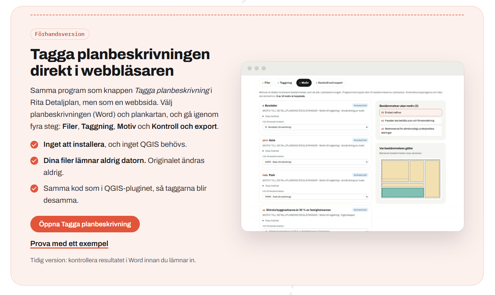

<h1 align="center">
  <picture>
    <source media="(prefers-color-scheme: dark)" srcset="docs/images/banner-mork.svg">
    
  </picture>
</h1>

Ett QGIS-plugin för att **rita detaljplaner och plankartor** enligt Lantmäteriets
[Nationell informationsspecifikation Detaljplan v4.1](https://www2.lantmateriet.se/globalassets/temawebbar/ngp/natspec-detaljplan-v4.1.pdf)
och Boverkets planbestämmelsekatalog, kontrollera dem mot Lantmäteriets regler, **tagga planbeskrivningen digitalt**
(BFS 2020:8) och **leverera planen till Nationella geodataplattformen (NGP)**. Målgrupp: planarkitekter och kartritare hos kommuner och konsulter.

**Webbsida:** [ritaplan.xyz](https://ritaplan.xyz), om Rita-pluginen.

**Tagga planbeskrivningen utan QGIS:** [ritaplan.xyz/tagga.html](https://ritaplan.xyz/tagga.html) är samma taggningsprogram som en
webbsida. Du behöver varken QGIS eller någon installation, och dina filer lämnar aldrig datorn (förhandsversion).

Öppen källkod, [GPL-2.0-or-later](LICENSE). Gränssnittet är på svenska.

Läs [Kända begränsningar](docs/kanda-begransningar.md) innan du använder pluginet till något viktigt, och rapportera
gärna fel under [Issues](https://github.com/ritaplan/rita-detaljplan/issues).

  

  

  

## Vad pluginet gör

- **Ritar planen i hierarki:** planområde → användning → egenskap, med snappning, fyllverktyg och regler som håller ytorna
  konsekventa medan du ritar. Egenskaper kan vara ytor, linjer (utfartsförbud, stängsel) och punkter (markens höjd).
- **Bestämmelser ur Boverkets katalog:** välj bland pågående planbestämmelser, fyll i värden och tilldela en eller flera
  bestämmelser per yta. Beteckningar (a1, e2 …) sätts automatiskt.
- **Höjd (3D):** en bestämmelse kan begränsas i höjdled med underkant och överkant (RH2000) och levereras som kropp
  eller yta med höjdvärde, så att till exempel ett garage under en gård kan ligga över samma mark.
- **Symbologi enligt Boverkets föreskrifter** med färger, mönster, gränser och etiketter, dimensionerade för vald
  referensskala.
- **Kontrollerar planen** mot Lantmäteriets regler (fel, varningar och sådant som återstår) och visar var i kartan.
- **Levererar till NGP** via Uppdatering-API:et, eller sparar leveransen som JSON-fil.
- **Taggar planbeskrivningen** (Word) enligt Boverkets föreskrifter BFS 2020:8 och Lantmäteriets Planbeskrivning 2.0:
  tema, grupp och undergrupp för varje avsnitt, motiv kopplade till planens bestämmelser, kontroll av det obligatoriska
  innehållet och en leverans- och granskningskopia av dokumentet. Knappen *Tagga planbeskrivning* öppnar programmet, som
  också finns som [webbsida utan QGIS](https://ritaplan.xyz/tagga.html). Originalet ändras aldrig.
- **Skapar detaljplanens teckenförklaring** i QGIS layoutläge (rubriker, färgrutor, mönster, genomförandetid), med
  inställningar för teckensnitt, storlekar och avstånd, och en **exempellayout för plankartan** (karta, norrpil,
  skalstock och titelruta på A2) att utgå från.
- **Förbereder för arkivering:** *Skapa arkivpaket* samlar planen (GeoPackage och leveransfil), plankartan och
  planbeskrivningen i en mapp med bevarandemetadata enligt Boverkets specifikation för långtidsbevarande (PREMIS), med
  kontrollsummor, och *Kontrollera arkivpaket* visar om något ändrats sedan dess. Plankarta och planbeskrivning lägger
  du med som färdiga PDF/A-filer; pluginet gör inte PDF/A.
- **Lagrar planen** i en lokal GeoPackage eller i ett PostGIS-schema, med **utcheckning och incheckning** (lås och
  lokal kopia) så att ritandet går snabbt även mot en databas.

## Installera

Kräver **QGIS 4.0 eller senare** (testat med 4.2.2 på Windows).

1. Ladda ned `rita_detaljplan-<version>.zip` från [Releases](https://github.com/ritaplan/rita-detaljplan/releases).
2. Starta QGIS och välj **Tillägg → Hantera och installera tillägg… → Installera från ZIP**.
3. Peka ut zip-filen och klicka **Installera tillägg**.
4. Under **Installerade** ska *Rita Detaljplan* vara ikryssat. Verktygsfältet **Rita Detaljplan** och menyn
   **Rita Detaljplan** visas.

**Eller som egen pluginkälla (då visas uppdateringar direkt i QGIS):**

1. Välj **Tillägg → Hantera och installera tillägg… → Inställningar** och klicka **Lägg till…** under *Pluginkällor*.
2. Ange valfritt namn och som URL
   `https://raw.githubusercontent.com/ritaplan/rita-detaljplan/main/plugins.xml`.
3. Kryssa i **Visa experimentella tillägg** (pluginet är en tidig utvecklingsversion), gå till **Alla** och installera
   *Rita Detaljplan*.

Uppdatera genom att installera en nyare zip på samma sätt (eller via pluginkällan). Ta bort ett äldre plugin som hette *Detaljplan NGP* (mappen
`detaljplan_ngp`) om du hade det.

Vill du köra direkt från källkoden, se [Utveckling](docs/utveckling.md).

## Snabbstart

1. **Rita Detaljplan → Ny detaljplan…**: välj kommun, koordinatsystem (SWEREF 99) och var planen ska lagras.
2. Klicka på **pennan** (*Börja rita planbestämmelser*) och rita **planområdet**.
3. Fyll i **Planens uppgifter** (namn, syfte, status, **genomförandetid** …) i dialogen som öppnas.
4. Rita **användningsområden** som täcker planområdet, och därefter **egenskapsområden** och linjer.
5. Klicka med **Planbestämmelser**-verktyget på en yta och välj bestämmelser ur katalogen.
6. Avsluta redigeringen (sparar planen). Kontrollera planen och leverera via **NGP**-knappen (moln med pil).
7. **Plankartan:** välj *Rita Detaljplan → Skapa exempellayout för plankarta…*, eller öppna en egen layout och klicka
   **Teckenförklaring** i verktygsfältet *Rita Detaljplan*.

Fler detaljer, steg för steg: [Användarhandbok](docs/anvandning.md), även på [ritaplan.xyz/handbok-dp.html](https://ritaplan.xyz/handbok-dp.html).

## Dokumentation

- [ritaplan.xyz](https://ritaplan.xyz): webbsidan om Rita-pluginen
- [Användarhandbok](docs/anvandning.md): steg för steg genom alla moment och verktyg
- [Tagga planbeskrivning i webbläsaren](https://ritaplan.xyz/tagga.html): taggningen som webbsida, utan QGIS och utan installation, med ett exempel att prova
- [Detaljplaner i en webbkarta (Origo)](https://github.com/ritaplan/rita-detaljplan-origomap): visa kommunens planer ur PostGIS i en Origo-karta, med plankarta, bestämmelser, motiv och handlingar
- [Detaljplaner i Hajk](https://github.com/ritaplan/rita-detaljplan-hajk): samma panel som ett plugin för Hajk 4, med inställningssida i Hajk Admin
- [Kända begränsningar](docs/kanda-begransningar.md): vad som inte är provat eller saknas
- [Regler från Lantmäteriets vägledning](docs/ngp-regler.md): underlag för kontrollen och exporten
- [Säkerhetsbeskrivning](docs/sakerhet.md): vad pluginet gör, vilka data som rör sig vart och vad som är granskat
- [OpenSSF Best Practices](docs/openssf-markning.md): underlag för märket för säker öppen källkod
- [Utveckling](docs/utveckling.md): köra koden och testerna, struktur, vägkarta
- [Ändringslogg](CHANGELOG.md)

## Bidra

Fel, önskemål och frågor tas emot under [Issues](https://github.com/ritaplan/rita-detaljplan/issues). Vill du bidra med
kod, läs [CONTRIBUTING](CONTRIBUTING.md). Säkerhetsfrågor: se [SECURITY](SECURITY.md).

## Licens och källor

GPL-2.0-or-later, se [LICENSE](LICENSE). Material från andra, som Lantmäteriets scheman, Boverkets
planbestämmelsekatalog och stilbiblioteket, står i [NOTICE](NOTICE.md).

Pluginet är inte en officiell produkt från Lantmäteriet eller Boverket.
